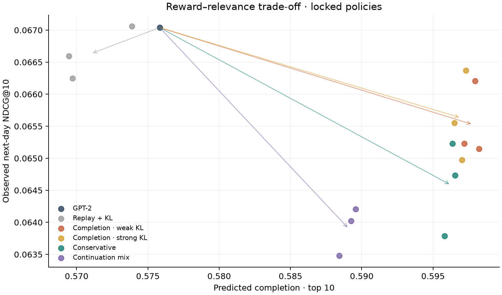
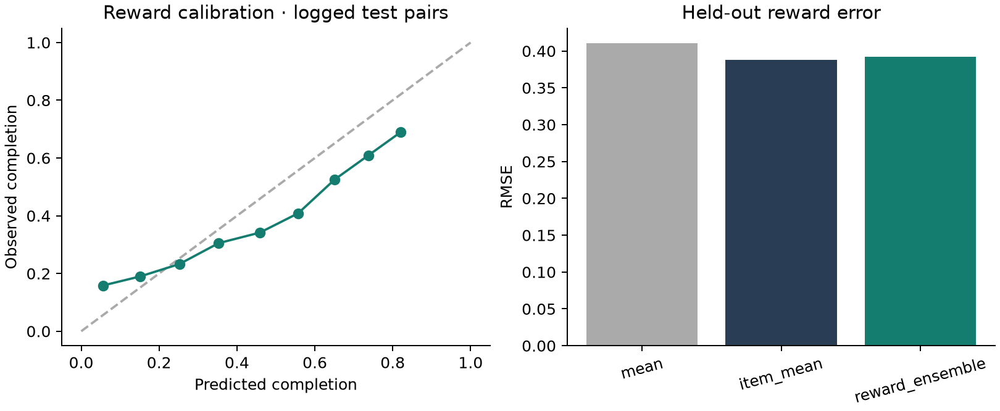
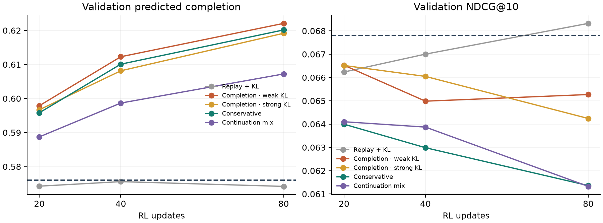
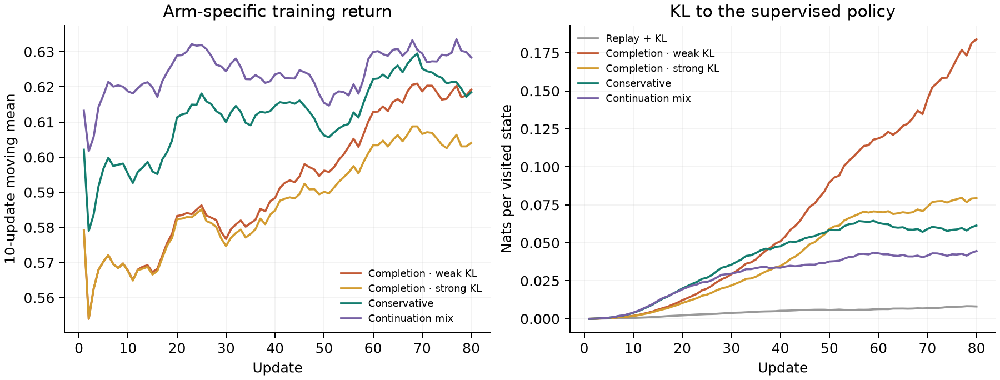
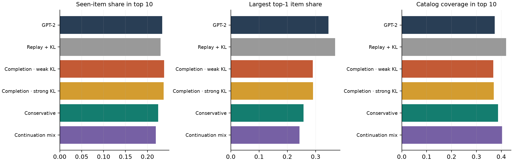
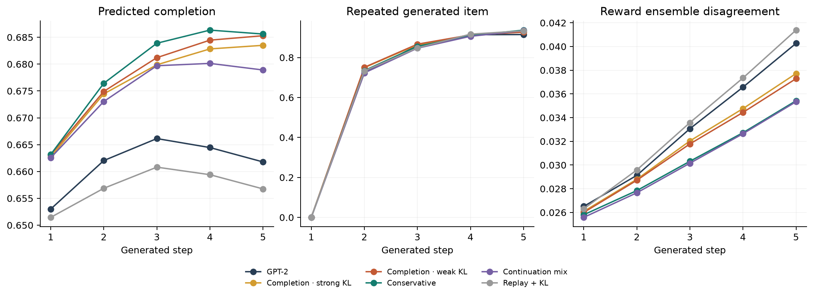

# Sequential recommendation with reward optimization

Исследование того, как дообучение с подкреплением меняет рекомендации GPT-2 на KION. Токен — идентификатор фильма или сериала; награду оценивает отдельная модель отклика по истории пользователя и предложенному объекту.

Главный вопрос — можно ли увеличить ожидаемую долю просмотра, сохранив релевантность и разнообразие. Поэтому вместе с reward измеряются попадание в следующие реальные просмотры, повторы, концентрация выдачи и поведение при генерации пяти объектов.



## Результаты

В этой постановке рост предсказанной награды сопровождается снижением средней релевантности. У всех четырёх вариантов с reward-gradient средний NDCG ниже базы; консервативные штрафы сокращают повторы в top-10, но не устраняют зацикливание жадной многошаговой генерации. Это отрицательный результат для выбранной модели награды и режима дообучения, а не доказательство бесполезности RL в рекомендациях.

Каждый вариант RL повторён с seed 42, 17 и 2026. Таблица показывает среднее по этим трём запускам; базовая модель одна, с seed 42. Это разброс RL при фиксированном предобучении, а не три независимых запуска всей системы.

| arm | ndcg10 | recall10 | predicted_completion10 | repeat10 | top1_share |
| --- | --- | --- | --- | --- | --- |
| GPT-2 | 0.0670 | 0.1169 | 0.5758 | 0.2339 | 0.3458 |
| Replay + KL | 0.0666 | 0.1176 | 0.5710 | 0.2299 | 0.3686 |
| Completion · weak KL | 0.0655 | 0.1116 | 0.5978 | 0.2379 | 0.2897 |
| Completion · strong KL | 0.0656 | 0.1117 | 0.5969 | 0.2372 | 0.2906 |
| Conservative | 0.0646 | 0.1123 | 0.5962 | 0.2245 | 0.2571 |
| Continuation mix | 0.0639 | 0.1126 | 0.5891 | 0.2190 | 0.2434 |

Для базовой модели NDCG@10 = **0.0670**, предсказанная доля просмотра = **0.5758**. Максимальное среднее предсказанное вознаграждение среди вариантов имеет **Completion · weak KL**: **0.5978**, NDCG@10 = **0.0655**. Это описание уже зафиксированных результатов, не выбор модели по тесту.

Предсказанная доля просмотра не является измеренной полезностью рекомендаций. Истинный отклик на новые выдачи в логе отсутствует. Ошибки модели награды, смещение наблюдавшейся политики и изменение контекста могут объяснять рост этой величины.

[Подробный разбор](reports/EXPERIMENT.md) · [Все метрики](results/test_metrics.csv) · [Парные доверительные интервалы](results/paired_bootstrap.csv) · [Протокол](PROTOCOL.md)

## Что изменилось

- **Replay + KL:** изменение NDCG относительно базы -0.0004, относительно Replay + KL +0.0000; изменение предсказанной доли просмотра -0.0048. Доля просмотренных объектов в top-10 — 23.0%, доля самого частого top-1 — 36.9%. Парный интервал NDCG целиком выше нуля у 0/3 seed, ниже нуля у 0/3.
- **Completion · weak KL:** изменение NDCG относительно базы -0.0015, относительно Replay + KL -0.0011; изменение предсказанной доли просмотра +0.0220. Доля просмотренных объектов в top-10 — 23.8%, доля самого частого top-1 — 29.0%. Парный интервал NDCG целиком выше нуля у 0/3 seed, ниже нуля у 2/3.
- **Completion · strong KL:** изменение NDCG относительно базы -0.0014, относительно Replay + KL -0.0010; изменение предсказанной доли просмотра +0.0211. Доля просмотренных объектов в top-10 — 23.7%, доля самого частого top-1 — 29.1%. Парный интервал NDCG целиком выше нуля у 0/3 seed, ниже нуля у 1/3.
- **Conservative:** изменение NDCG относительно базы -0.0025, относительно Replay + KL -0.0021; изменение предсказанной доли просмотра +0.0204. Доля просмотренных объектов в top-10 — 22.5%, доля самого частого top-1 — 25.7%. Парный интервал NDCG целиком выше нуля у 0/3 seed, ниже нуля у 3/3.
- **Continuation mix:** изменение NDCG относительно базы -0.0031, относительно Replay + KL -0.0027; изменение предсказанной доли просмотра +0.0133. Доля просмотренных объектов в top-10 — 21.9%, доля самого частого top-1 — 24.3%. Парный интервал NDCG целиком выше нуля у 0/3 seed, ниже нуля у 3/3.

Значимость в отдельных запусках не означает устойчивость между периодами. При проверке многих вариантов эти интервалы служат диагностикой, а не основанием выбрать победителя на тесте.

## Модель отклика

Ансамбль из трёх небольших нейросетей предсказывает два сигнала: долю просмотра и наличие следующего взаимодействия в течение семи дней. Входы — усреднённые обучаемые эмбеддинги истории, эмбеддинг кандидата, их произведение, длина контекста. Идентификатор пользователя, длительность и доля просмотра кандидата во входы не входят.

| model | rmse | mae | r2 | auc_completion80 |
| --- | --- | --- | --- | --- |
| mean | 0.4106 | 0.3832 | -0.0615 | 0.5000 |
| item_mean | 0.3884 | 0.3454 | 0.0502 | 0.6786 |
| reward_ensemble | 0.3924 | 0.3448 | 0.0306 | 0.6887 |

На тесте RMSE ансамбля — **0.3924**, сглаженного среднего по объекту — **0.3884**. Ансамбль не показывает преимущества по этой метрике. Средняя доля просмотра изменилась с 0.553 в обучающих примерах до 0.454 в тестовых. Это сдвиг распределения, который важно учитывать при интерпретации награды.



Reward model оценивается на реально наблюдавшихся тестовых парах с историей до даты каждой пары; это отдельный протокол от фиксированного контекста ранжирования.

Перемешивание историй между тестовыми примерами даёт RMSE **0.3948**. Эта диагностика показывает, насколько модель использует соответствие истории и кандидата; сама по себе она не подтверждает качество контрфактических оценок.

Для предсказания продолжения: AUC **0.7205**, Brier **0.2153**, Brier константы из обучения **0.2246**, наблюдений с полным горизонтом **3468**. Это условная корреляция на просмотренных объектах, не оценка эффекта рекомендации на возвращаемость.

## Протокол

- **Данные:** 12,000 пользователей с не менее чем пятью взаимодействиями до 12 июля; 200,358 пар во всей выбранной истории. Будущая активность не участвовала в выборе пользователей.
- **Каталог:** 1 000 наиболее частых объектов только по обучению; ещё два токена — padding и неизвестный объект. Покрытие обучающих взаимодействий: 75.4%; покрытие тестовых целей: 54.1%.
- **Обучение:** цели до 12 июля 2021; 80,000 примеров после заранее заданного ограничения.
- **Выбор базовой модели и reward model:** 12–25 июля. **Контексты RL:** история до 26 июля. **Выбор RL-checkpoint:** 2–8 августа. **Тест:** 9–22 августа.
- **Оценка:** фиксированная история на начало периода; релевантны все объекты первого следующего наблюдаемого дня. NDCG и Recall — по 3,446 активным пользователям; поведение выдачи — по всем 12,000. Отдельно сохранён NDCG по всем пользователям.

При таком словаре верхняя граница macro Recall — 0.5591, NDCG@10 — 0.5772, даже при идеальном порядке доступных объектов.

У событий внутри дня нет известного порядка: целевой пример использует только предыдущие дни. Порядок исторических событий с одинаковой датой определяется ID объекта. Неизвестные цели остаются в знаменателях Recall и NDCG. Основная оценка не исключает просмотренные объекты, чтобы обнаруживать повторы; в CSV дополнительно есть результаты с фильтром просмотренного.

## Дообучение

Модель — `GPT2LMHeadModel` с нуля: 2 блока, 4 головы внимания, размер эмбеддинга 64, контекст 32. Базовое обучение использует next-item cross-entropy. Восьми эпохам соответствует восемь проверок на development; сохраняется лучший NDCG.

REINFORCE генерирует четыре независимые пятишаговые траектории на каждый из 16 контекстов. Полная дисконтированная награда использует γ = 0.95. Для снижения дисперсии применяется leave-one-out baseline по остальным трём траекториям того же пользователя. Награда и baseline отделены от градиентов; обучается только политика.

Сравниваются чистая доля просмотра с KL-коэффициентами 0.01 и 0.15; консервативная награда со штрафами за повторы и расхождение ансамбля; смесь доли просмотра и вероятности продолжения. Во всех вариантах одинаковый supervised replay. Контроль `Replay + KL` не использует reward-gradient.

Checkpoint выбирается на 20, 40 или 80 обновлении по максимальному validation NDCG среди вариантов, не снижающих предсказанную долю просмотра относительно базы. Если таких нет, выбирается максимальный NDCG и фиксируется невыполнение ограничения. Для повторных seed используется уже выбранное число шагов. [Конфигурации](results/locked_policies.json) зафиксированы до финальной оценки.



Этот график относится к выбору моделей до теста. Он показывает цену дополнительных шагов обучения; пунктир — исходная GPT-2.



Кривые возврата используют разные функции награды, поэтому их абсолютные уровни между вариантами несопоставимы. Показан seed 42 и скользящее среднее по 10 обновлениям.



## Пять шагов вперёд



После каждого выбора токен рекомендации добавляется в историю. Это **воображаемое действие**, а не подтверждённый просмотр. Вторая диагностика оставляет исходный контекст неизменным. При жадном выборе без фильтров такой контроль повторяет один и тот же объект — ожидаемое свойство процедуры, а не ошибка измерения.

Пошаговые оценки награды, расхождение ансамбля, повторы внутри списка и совпадения с реальной историей сохранены в [таблице](results/rollout_summary.csv). Есть [примеры выдачи](results/rollout_examples.json). Эти измерения позволяют увидеть дрейф, но не заменяют модель переходов пользователя.

## Воспроизведение

```bash
git clone https://github.com/KarinaSH7/kion-sequential-rl.git
cd kion-sequential-rl
python3.11 -m venv .venv
source .venv/bin/activate
python -m pip install -r requirements-lock.txt
python -m pytest -q
```

Результаты и checkpoints исходного эксперимента уже включены. Перед полным повтором сохраните их:

```bash
mv results results_reference
PYTHON=.venv/bin/python bash run.sh
```

Нужен интернет для загрузки KION; дальше расчёт локальный, на CPU с четырьмя потоками. Сырые данные не хранятся в Git. Контрольные суммы источника проверяются при загрузке. `src.report` заново строит графики и отчёт из результатов без обучения.

| Код | Назначение |
|---|---|
| `src/data.py` | Когорта, словарь, временные примеры и цензурирование |
| `src/models.py` | GPT-2 и модель отклика |
| `src/train.py` | Предобучение, reward fitting, RL и выбор checkpoints |
| `src/evaluate.py` | Ранжирование и диагностика поведения |
| `src/final.py` | Оценка зафиксированных политик и bootstrap |
| `src/audit.py` | Временные проверки и независимый пересчёт метрик |

## Ограничения

KION содержит агрегированные пары и последнюю дату просмотра, а не журнал показов и сессий. Условная доля просмотра наблюдается только после взаимодействия. Нет вероятностей показов, отрицательных показов и причинной разметки удержания, поэтому IPS/DR-оценка новой политики здесь не заявляется.

В метаданных нет надёжной длительности фильма. Нельзя вычислять её из `total_dur / watched_pct`: это использует отклик и агрегированные повторные просмотры. Поэтому смещение к коротким объектам остаётся непроверенным риском, а не установленным результатом.

Эксперимент ограничен активной когортой, популярным каталогом, одной временной проверкой и небольшой GPT-2. Предсказания ансамбля могут ошибаться согласованно; его расхождение — эвристика неопределённости, а не гарантия защиты от эксплуатации reward model.

## Источники

- [KION dataset](https://github.com/irsafilo/KION_DATASET), фиксированная версия `f69775be31fa5779907cf0a92ddedb70037fb5ae`. Petrov et al., *MTS Kion Implicit Contextualised Sequential Dataset for Movie Recommendation*, 2022.
- [Petrov & Macdonald, 2024](https://arxiv.org/abs/2403.04875): GPTRec и оптимизация критериев за пределами точности. Здесь используется самостоятельная компактная постановка, без teacher–student стадии из статьи.
- [Matveev et al., 2026](https://arxiv.org/abs/2607.02818): последовательная оптимизация и off-policy correction. Наш on-policy sampling внутри фиксированной модели награды не воспроизводит их off-policy estimator.
- [GPT-2 implementation](https://huggingface.co/docs/transformers/model_doc/gpt2).

Карина Шаля · T Lab · задание 2.
